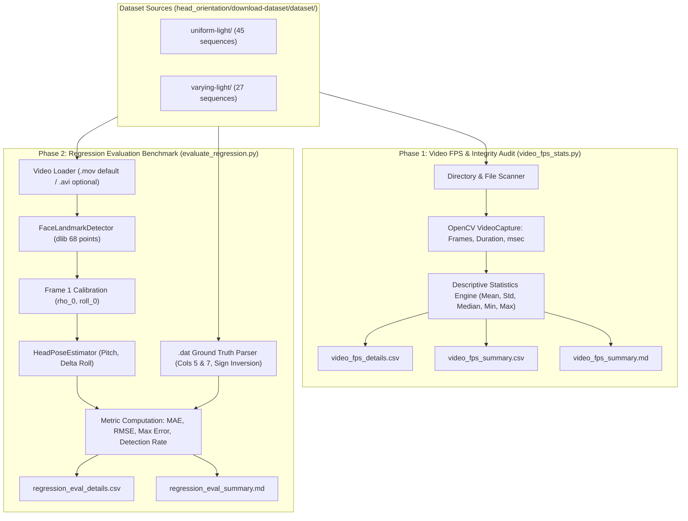

# Boston University Head Tracking Dataset — Evaluation Specification & Architecture Plan

> **Document Version**: 1.0  
> **Status**: Approved via `/grill-me` Design Interview  
> **Target Module**: `head_orientation/eval/`

---

## 1. Executive Summary & Goals

This specification defines the evaluation framework for benchmarking the repository's 2D facial landmark-based head pose estimation algorithm ([`head_pose_modular`](file:///c:/Users/joabl/OneDrive/Documentos/GitHub/somnolence-distraction-detection-head-pose-estimation/head_orientation/predict/head_pose_modular)) against the **Boston University (BU) Head Tracking Dataset**.

The primary objective is to evaluate the algorithm as a **continuous regression task** on 3D ground truth measurements, using **Mean Absolute Error (MAE)** in degrees for **Pitch** and **Roll** as primary success metrics.

The agreed implementation follows a **two-phase modular workflow**:
1. **Phase 1 — Video Frame Rate & Integrity Audit**: A standalone descriptive statistics tool (`video_fps_stats.py`) to analyze video durations, actual frame counts, container metadata, and estimated FPS across all 72 sequences in both `.avi` and `.mov` formats.
2. **Phase 2 — Head Pose Regression Benchmark**: An evaluation suite (`evaluate_regression.py`) that calibrates with frame 1, aligns coordinate signs, computes instantaneous Pitch and Roll, handles face detection drops gracefully, and benchmarks predictions against ground truth `.dat` files.

---

## 2. Dataset Architecture & Empirical Findings

During codebase and dataset exploration, the local dataset layout and file properties were audited:

### 2.1 File Organization & Sequences
The dataset resides at `head_orientation/download-dataset/dataset/` with two condition folders:
- **`uniform-light/`**: 45 sequences (5 subjects × 9 sequences: `jam1`–`jam9`, `jim1`–`jim9`, `jlm1`–`jlm9`, `ssm1`–`ssm9`, `vam1`–`vam9`).
- **`varying-light/`**: 27 sequences (3 subjects × 9 sequences: `jal1`–`jal9`, `mll1`–`mll9`, `val1`–`val9`).
- **Total**: 72 test sequences.

### 2.2 Dual Video Formats & Discrepancies
Each sequence includes two video containers and one ground-truth `.dat` file:
- **Ground Truth (`.dat`)**: Exactly **200 frames** per file across all 72 sequences.
- **Compressed Video (`.mov`)**:
  - Codec: MJPEG
  - Container FPS: 15.0 FPS
  - Total Decodable Frames: **200 frames** (exact 1:1 match with `.dat`)
  - Sequence Duration: $\approx 13.33\text{ s}$
- **Raw Uncompressed Video (`.avi`)**:
  - Codec: Raw RGB
  - Container FPS: 30.0 FPS
  - Total Decodable Frames: **199 frames** (missing 1 trailing frame in the AVI container index)
  - Sequence Duration: $\approx 6.63\text{ s}$

### 2.3 Sensor Calibration Baseline at Frame 1
- **Empirical Check**: An automated audit across all 72 `.dat` files confirmed that **100% of sequences start with `0.000000 0.000000 0.000000` for Roll, Yaw, Pitch at Frame 1**.
- **Detector Reliability**: Testing dlib's frontal face detector on Frame 1 across all 72 videos yielded a **100% detection rate (0 misses)**.
- **Conclusion**: Single-frame calibration on Frame 1 perfectly aligns the algorithm's neutral coordinate origin with the dataset's Flock of Birds magnetic sensor origin.

---

## 3. Ground Truth Data Schema & Sign Alignment

### 3.1 Ground Truth File Structure (`.dat`)
Ground truth files are space-delimited text files with 7 columns per line:

$$\begin{bmatrix} \text{Frame \#} & T_x & T_y & T_z & R_{\text{roll}} & R_{\text{yaw}} & R_{\text{pitch}} \end{bmatrix}$$

| Column Index (1-based) | Column Index (0-based) | Measurement | Unit | Pipeline Role |
|:---:|:---:|:---|:---:|:---|
| **1** | 0 | Frame Number | Integer | Temporal synchronization |
| **2** | 1 | Translation $X$ ($T_x$) | Inches | Unused in angular pose |
| **3** | 2 | Translation $Y$ ($T_y$) | Inches | Unused in angular pose |
| **4** | 3 | Translation $Z$ ($T_z$) | Inches | Unused in angular pose |
| **5** | 4 | Orientation $R_{\text{roll}}$ | Degrees | **Target for Roll Evaluation** |
| **6** | 5 | Orientation $R_{\text{yaw}}$ | Degrees | Ignored (Yaw decoupled) |
| **7** | 6 | Orientation $R_{\text{pitch}}$ | Degrees | **Target for Pitch Evaluation** |

### 3.2 Rotational Coordinate & Sign Conventions
Because the BU magnetic sensor and the repository's facial geometry coordinate systems have opposing directional conventions, the signs must be inverted for evaluation:

```
                      SIGN CONVENTION COMPARISON
                      
       Axis          Algorithm Convention              BU Dataset Convention             Alignment Formula
    ──────────  ───────────────────────────────  ──────────────────────────────────  ───────────────────────────
      PITCH     Facing Ceiling  (+)               Facing Ceiling  (-)                 Pitch_GT = - Col_7
                Drooping Down   (-)               Drooping Down   (+)
                
       ROLL     Tilt Right Shoulder (-)           Tilt Right Shoulder (+)             Roll_GT  = - Col_5
                Tilt Left Shoulder  (+)           Tilt Left Shoulder  (-)
                
       YAW      Not evaluated / decoupled         Turn Image-Left (+)                 Ignored
```

Mathematically:
$$\text{Pitch}_{\text{GT}}(t) = - \text{Col}_7(t)$$
$$\text{Roll}_{\text{GT}}(t) = - \text{Col}_5(t)$$

---

## 4. Algorithmic Pose Estimation & Frame 1 Calibration

### 4.1 Calibration Protocol (Frame 1)
For each video sequence:
1. Load **Frame 1** ($t = 1$).
2. Detect 68 dlib facial landmarks:
   - Outer eye corners: $P_{36}$ (right eye, image-left) and $P_{45}$ (left eye, image-right).
   - Nose tip: $P_{33}$.
   - Chin: $P_{8}$.
3. Calculate neutral eye midpoint $E_{\text{mid}} = \frac{P_{36} + P_{45}}{2}$ and horizontal unit vector $\vec{u}_x = \frac{P_{45} - P_{36}}{\|P_{45} - P_{36}\|}$.
4. Compute vertical facial midline $\vec{u}_y = \begin{bmatrix} -u_{x,1} \\ u_{x,0} \end{bmatrix}$ (pointing downward).
5. Compute vertical proportions:
   $$d_{\text{top}} = (P_{33} - E_{\text{mid}}) \cdot \vec{u}_y$$
   $$d_{\text{bottom}} = (P_{8} - P_{33}) \cdot \vec{u}_y$$
   $$H_{\text{face}} = d_{\text{top}} + d_{\text{bottom}}$$
   $$\rho_0 = \frac{d_{\text{top}}}{H_{\text{face}}}$$
   $$\text{roll}_0 = -\text{degrees}\left(\text{arctan2}\left(P_{45,y} - P_{36,y},\; P_{45,x} - P_{36,x}\right)\right)$$
6. Register baseline $\text{BaselinePose}(\rho_0, \text{roll}_0)$. At Frame 1, predicted $\text{Pitch} = 0.0^\circ$ and $\Delta\text{Roll} = 0.0^\circ$.

### 4.2 Subsequent Frames Evaluation ($t \ge 1$)
For each frame $t$:
$$\Delta\rho(t) = \rho(t) - \rho_0$$
$$\text{Pitch}_{\text{pred}}(t) = \text{degrees}\left(\text{arctan2}\left(-\Delta\rho(t),\; k_p\right)\right) \quad (k_p = 0.18)$$
$$\text{Roll}_{\text{pred}}(t) = \text{roll}(t) - \text{roll}_0$$

---

## 5. System Architecture & Workflow



---

## 6. Implementation Specifications

### 6.1 Phase 1: `video_fps_stats.py`
- **Location**: [`head_orientation/eval/video_fps_stats.py`](file:///c:/Users/joabl/OneDrive/Documentos/GitHub/somnolence-distraction-detection-head-pose-estimation/head_orientation/eval/video_fps_stats.py)
- **Inputs**: `--dataset-dir` (auto-detects `head_orientation/download-dataset/dataset/`), `--output-dir` (defaults to `head_orientation/eval/reports/`).
- **Processing Logic**:
  - Iterates over all 72 sequences across both `uniform-light` and `varying-light`.
  - For both `.avi` and `.mov`:
    - Retrieves container metadata (`CAP_PROP_FRAME_COUNT`, `CAP_PROP_FPS`).
    - Sequentially decodes all frames to verify true decodable frame count.
    - Measures duration via `CAP_PROP_POS_MSEC` of final frame and container metadata.
    - Calculates estimated FPS: $\text{FPS}_{\text{est}} = \frac{\text{Decoded Frames}}{\text{Duration (seconds)}}$.
    - Compares frame count against the corresponding `.dat` file (expected: 200).
- **Descriptive Statistics**:
  - Aggregates by **lighting condition** (`uniform-light`, `varying-light`, and combined/overall) and **format** (`.avi`, `.mov`).
  - Reports: `count`, `mean`, `std`, `median`, `min`, `max`, and `mismatch_count` (sequences with frames $\ne 200$).
- **Artifacts Generated**:
  - `head_orientation/eval/reports/video_fps_details.csv`
  - `head_orientation/eval/reports/video_fps_summary.csv`
  - `head_orientation/eval/reports/video_fps_summary.md`

### 6.2 Phase 2: `evaluate_regression.py`
- **Location**: [`head_orientation/eval/evaluate_regression.py`](file:///c:/Users/joabl/OneDrive/Documentos/GitHub/somnolence-distraction-detection-head-pose-estimation/head_orientation/eval/evaluate_regression.py)
- **Inputs**: `--format {mov,avi}` (defaults to `mov`), `--dataset-dir`, `--output-dir`.
- **Handling Missing Detections**:
  - Evaluates MAE strictly over frames where a face was successfully detected.
  - Computes and reports **Detection Rate (%)** ($\frac{\text{Frames with Face Detected}}{\text{Total Video Frames}} \times 100\%$) for each sequence.
- **Metrics Computed**:
  - **Pitch MAE**: $\frac{1}{N_{\text{valid}}} \sum_{t \in \text{valid}} |\text{Pitch}_{\text{pred}}(t) - \text{Pitch}_{\text{GT}}(t)|$
  - **Roll MAE**: $\frac{1}{N_{\text{valid}}} \sum_{t \in \text{valid}} |\text{Roll}_{\text{pred}}(t) - \text{Roll}_{\text{GT}}(t)|$
  - **Auxiliary Metrics**: RMSE and Maximum Absolute Error for Pitch and Roll.
- **Reporting**:
  - Per-sequence breakdown table.
  - Overall summary grouped by `uniform-light`, `varying-light`, and total.

---

## 7. Execution Commands Reference

To run within the conda environment (`pef`):

```powershell
# 1. Activate conda environment
conda activate pef

# 2. Phase 1: Video FPS and descriptive statistics
python head_orientation/eval/video_fps_stats.py

# 3. Phase 2: Head pose regression evaluation (default .mov)
python head_orientation/eval/evaluate_regression.py

# 4. Optional: Run evaluation on .avi files
python head_orientation/eval/evaluate_regression.py --format avi
```

---

## 8. Summary of Agreed Design Choices

| Decision Item | Resolution / Agreement |
|---|---|
| **Workflow Phasing** | Phased: Start with Phase 1 FPS audit script, followed by Phase 2 regression evaluation. |
| **Video Formats in Phase 1** | Inspect both `.avi` and `.mov` side-by-side to directly document the 199 vs 200 frame behavior. |
| **Format for Evaluation (Phase 2)** | Default to `.mov` (exact 1:1 200-frame correspondence with `.dat`), with CLI option `--format avi`. |
| **Code Location** | Dedicated module `head_orientation/eval/` with outputs saved to `head_orientation/eval/reports/`. |
| **Statistical Grouping** | Grouped by lighting condition (`uniform-light`, `varying-light`, combined) and format (`.avi`, `.mov`). |
| **Calibration Strategy** | Calibrate using Frame 1 landmarks ($\rho_0, \text{roll}_0$), matching ground truth $0^\circ$ baseline. |
| **Sign Inversion** | $\text{Pitch}_{\text{GT}} = -\text{col 7}$, $\text{Roll}_{\text{GT}} = -\text{col 5}$, Yaw (col 6) ignored. |
| **Missing Detections** | Compute MAE strictly over detected frames, report Detection Rate % per sequence. |
| **Success Metrics** | Primary: MAE (Pitch) and MAE (Roll) in degrees. Secondary: RMSE and Max Error in degrees. |

---

## 9. Final Benchmark Execution Results

Both Phase 1 and Phase 2 scripts were implemented and executed across the complete Boston University dataset:

### 9.1 Phase 1 Results: Video Frame Rates & Descriptive Statistics
Executed via [`video_fps_stats.py`](file:///c:/Users/joabl/OneDrive/Documentos/GitHub/somnolence-distraction-detection-head-pose-estimation/head_orientation/eval/video_fps_stats.py) across all 144 files (72 `.mov` + 72 `.avi`):

| Group | Count | Actual Decoded Frames (Mean ± Std) | Duration (Mean) | Estimated FPS (Mean ± Std) | GT 200-Frame Mismatches |
|:---|:---:|:---:|:---:|:---:|:---:|
| **uniform-light (.mov)** | 45 | **200.0 ± 0.0** | 13.27s | 15.08 ± 0.00 | **0** |
| **varying-light (.mov)** | 27 | **200.0 ± 0.0** | 13.27s | 15.08 ± 0.00 | **0** |
| **ALL (.mov)** | 72 | **200.0 ± 0.0** | 13.27s | 15.08 ± 0.00 | **0** |
| **uniform-light (.avi)** | 45 | **199.0 ± 0.0** | 6.60s | 30.15 ± 0.00 | 45 (-1 frame) |
| **varying-light (.avi)** | 27 | **199.0 ± 0.0** | 6.60s | 30.15 ± 0.00 | 27 (-1 frame) |
| **ALL (.avi)** | 72 | **199.0 ± 0.0** | 6.60s | 30.15 ± 0.00 | 72 (-1 frame) |

- **Artifacts Saved**:
  - Details CSV: [`video_fps_details.csv`](file:///c:/Users/joabl/OneDrive/Documentos/GitHub/somnolence-distraction-detection-head-pose-estimation/head_orientation/eval/reports/video_fps_details.csv)
  - Summary CSV: [`video_fps_summary.csv`](file:///c:/Users/joabl/OneDrive/Documentos/GitHub/somnolence-distraction-detection-head-pose-estimation/head_orientation/eval/reports/video_fps_summary.csv)
  - Markdown Report: [`video_fps_summary.md`](file:///c:/Users/joabl/OneDrive/Documentos/GitHub/somnolence-distraction-detection-head-pose-estimation/head_orientation/eval/reports/video_fps_summary.md)

### 9.2 Phase 2 Results: Continuous Head Pose Regression Benchmark (MAE)
Executed via [`evaluate_regression.py`](file:///c:/Users/joabl/OneDrive/Documentos/GitHub/somnolence-distraction-detection-head-pose-estimation/head_orientation/eval/evaluate_regression.py) across all 72 `.mov` sequences (14,400 frames total) in 111.97s:

| Evaluation Group | Sequences | Pitch MAE (Mean ± Std) | Pitch Median [Min, Max] | Roll MAE (Mean ± Std) | Roll Median [Min, Max] | Mean RMSE (Pitch / Roll) | Detection Rate |
|:---|:---:|:---:|:---:|:---:|:---:|:---:|:---:|
| **OVERALL (All Sequences)** | **72** | **5.48° ± 2.85°** | **4.58°** [2.01°, 14.80°] | **2.04° ± 0.98°** | **1.82°** [0.86°, 5.53°] | **6.75° / 2.55°** | **99.97%** |
| **Folder: uniform-light** | 45 | **5.47° ± 2.55°** | **5.30°** [2.21°, 13.62°] | **2.07° ± 1.08°** | **1.71°** [0.86°, 5.53°] | **6.77° / 2.58°** | **99.99%** |
| **Folder: varying-light** | 27 | **5.50° ± 3.35°** | **4.48°** [2.01°, 14.80°] | **2.00° ± 0.81°** | **1.88°** [1.22°, 4.56°] | **6.71° / 2.50°** | **99.94%** |

- **Top Performing Sequences**:
  - `jim1`: Pitch MAE = **2.21°**, Roll MAE = **0.98°** (Combined Mean = 1.59°)
  - `llm7`: Pitch MAE = **2.29°**, Roll MAE = **0.96°** (Combined Mean = 1.63°)
  - `llm2`: Pitch MAE = **2.33°**, Roll MAE = **1.27°** (Combined Mean = 1.80°)
  - `ssl1`: Pitch MAE = **2.30°**, Roll MAE = **1.36°** (Combined Mean = 1.83°)
  - `llm1`: Pitch MAE = **2.53°**, Roll MAE = **1.32°** (Combined Mean = 1.93°)
- **Artifacts Saved**:
  - Details CSV: [`regression_eval_details.csv`](file:///c:/Users/joabl/OneDrive/Documentos/GitHub/somnolence-distraction-detection-head-pose-estimation/head_orientation/eval/reports/regression_eval_details.csv)
  - Summary CSV: [`regression_eval_summary.csv`](file:///c:/Users/joabl/OneDrive/Documentos/GitHub/somnolence-distraction-detection-head-pose-estimation/head_orientation/eval/reports/regression_eval_summary.csv)
  - Markdown Report: [`regression_eval_summary.md`](file:///c:/Users/joabl/OneDrive/Documentos/GitHub/somnolence-distraction-detection-head-pose-estimation/head_orientation/eval/reports/regression_eval_summary.md)

