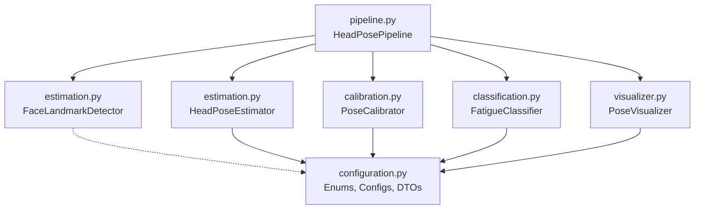

# Architecture Rationale: Modular Design & "Small Classes" in Python

> **Audience**: Engineers, reviewers, and maintainers looking to understand how the head pose estimation codebase evolved from a monolithic prototype into a component-aware package, and why specific design patterns (dataclasses, enums, domain separation) were chosen over simple loose variables or heavy OOP hierarchies.

---

## 1. Executive Summary & Problem Context

All logic was concentrated in single monolithic scripts:
- Global constants were scattered across the top of the file (`KP_PITCH = 0.18`, `PITCH_THRESH_MILD = -8.0`, `CALIBRATION_FRAMES = 60`).
- Computer vision I/O (`cv2`, `dlib`), geometric vector calculations, temporal state buffering, alert thresholding, and GUI rendering were tightly interwoven.
- Data passed between functions as loose dictionaries (`{"rho": ..., "roll": ...}`) or raw tuples.

While rapid to prototype, this structure becomes brittle as the system grows:
1. **Hidden coupling**: Changing a threshold requires finding where global variables are accessed.
2. **Untestable components**: Testing fatigue debouncing requires running a full webcam capture loop or monkeypatching module globals.
3. **Magic numbers**: Numbers like `36`, `45`, `33`, and `8` are scattered across equations without semantic context.

To solve this, we migrated to the package at [`head_orientation/predict/head_pose_modular/`](file:///head_orientation/predict/head_pose_modular/).


## 2. The Modular File Layout

Rather than scattering code across 15 single-class files (the Java anti-pattern), the codebase is organized into **cohesive functional boundaries**:

```
head_orientation/predict/head_pose_modular/
├── __init__.py           # Unified public package interface
├── configuration.py      # Pure data schemas, enums, DTOs (zero I/O dependencies)
├── estimation.py         # Spatial coordinate frame & 2D landmark projection math
├── calibration.py        # Neutral baseline accumulation & median estimation
├── classification.py     # Temporal state debouncing & alert rule evaluation
├── visualizer.py         # OpenCV HUD presentation & graphics rendering
├── pipeline.py           # Acquisition loop & component wiring
└── __main__.py           # CLI entry point
```

### 2.1 Dependency Direction & Architecture Flow

The architecture follows a strict downward dependency flow, avoiding circular imports:



### 2.2 Detailed Module Responsibilities

| Module | Core Responsibility | Why It Is Separated |
| :--- | :--- | :--- |
| **`configuration.py`** | Pure contracts: Enums (`PitchLevel`, `RollLevel`), configs (`*Config`), and DTOs (`PoseMetrics`, `BaselinePose`, `FatigueAssessment`). | Has **zero heavy dependencies** (no OpenCV, no dlib). Any component or external consumer can import types without triggering C++ library loads. |
| **`estimation.py`** | Spatial geometry: `FaceLandmarkDetector` (dlib) and `HeadPoseEstimator` (vector projection, $\rho$ ratio). | Purely answers: *"Given this image, what are the head orientation angles right now?"* Stateless with respect to past frames. |
| **`calibration.py`** | Temporal baseline aggregation: `PoseCalibrator`. | Separated because baseline strategies frequently evolve (e.g. outlier filtering, rolling window drift adaptation, confidence weighting) without impacting classification logic. |
| **`classification.py`** | Decision logic & hysteresis: `FatigueClassifier`. | Separated because fatigue detection rules evolve independently (e.g. adding PERCLOS eye blink detection, yaw distraction, or machine learning classifiers). |
| **`visualizer.py`** | Presentation layer: `PoseVisualizer`. | Isolates all OpenCV rendering. Can be completely omitted or swapped when deploying headless (e.g. vehicle CAN bus daemon, cloud video analysis, or web dashboard). |
| **`pipeline.py`** | Orchestration: `HeadPosePipeline`. | Wires dependencies together and runs the camera loop. Does not contain any math or business rules. |

---
## 3. The Philosophy: Defending "Small Classes"

A common critique from developers favoring raw scripts is:
> *"Why create a 3-line class for something that could just be a dictionary or a tuple? Isn't this Java-style over-engineering?"*

Here is why explicit small dataclasses provide massive leverage in Python:

### 3.1 Eliminating "Dict-Typo" Bugs at Zero Cost
Consider passing baseline results around:

```python
# Loose dictionary approach
baseline = {"rho": 0.42, "roll": 2.1}
...
# Later in another function:
delta = metrics["rho"] - baseline["ro"]  # KeyError or silent bug!
```

Versus:

```python
@dataclass(frozen=True)
class BaselinePose:
    rho: float
    roll: float

delta = metrics.rho - baseline.rho  # IDE auto-completes; typo flagged immediately by linter/mypy
```

A 4-line dataclass costs virtually nothing in development time, but:
- It serves as a **formal contract** between pipeline stages.
- Linters (like `mypy`, `pyright`, or IDE language servers) catch typos before the code ever runs.
- You never have to search the codebase to see what keys exist in a dictionary.

### 3.2 Semantic Landmark Indices vs. Magic Numbers
In dlib's 68-point model, landmarks are referenced by integer offsets:
- `36` = Right eye outer corner
- `45` = Left eye outer corner
- `33` = Nose tip
- `8`  = Chin

Writing `points[33]` and `points[8]` in mathematical code is opaque. A reader must memorize dlib's topology diagram.

Wrapping this in [`LandmarkIndices`](file:///head_orientation/predict/head_pose_modular/configuration.py):

```python
@dataclass(frozen=True)
class LandmarkIndices:
    right_eye_outer: int = 36
    left_eye_outer: int = 45
    nose_tip: int = 33
    chin: int = 8
```

transforms `points[33]` into `points[idx.nose_tip]`. The code becomes **self-documenting anthropometric geometry**.

---

## 4. Summary: Pragmatic Rules of Thumb for Python Design

When deciding whether to extract variables into classes or split files in Python:

1. **Rule of Three & Domain Affinity**: Group constants that belong to the same component lifecycle into a `@dataclass(frozen=True)`. Do not build a single monolithic "God Config".
2. **Enums for States, Dataclasses for Quantities**: Use `StrEnum` for discrete categorical variants (`NORMAL`, `WARNING`). Use dataclasses for tunable numeric settings (`pitch_thresh_mild = -8.0`).
3. **DTOs over Dictionaries across Component Boundaries**: Inside a tight private loop, a dictionary or namedtuple is fine. When passing data between two distinct components (e.g., from `Estimator` to `Classifier`), use a typed dataclass.
4. **Cohesion over Fragmentation**: Avoid the "one file per class" trap. Group tightly related small classes (like schemas and configs) into a single cohesive module (`configuration.py`). Separate files only along clear operational boundaries (math vs. temporal state vs. presentation).
