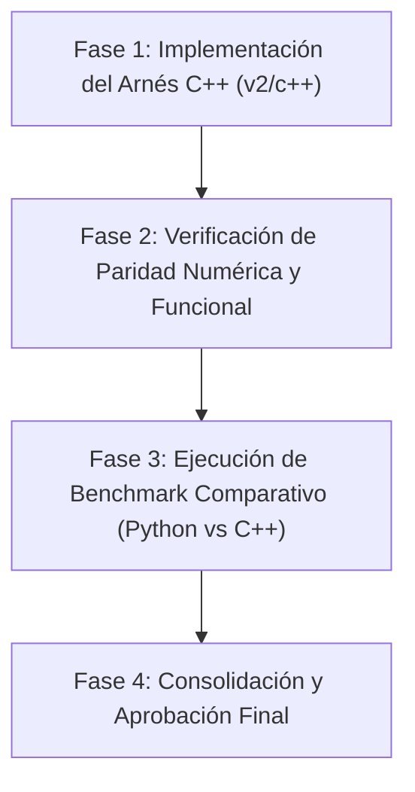

# Plan de Migración a C++: Head Pose Estimation & Benchmarking (v2)

Este documento detalla el análisis de viabilidad, ganancias de rendimiento estimadas, consideraciones arquitectónicas críticas y la hoja de ruta para la migración de [`head_pose_simple.py`](../../head_pose_simple.py) y su arnés de benchmarking a **C++17**.

---

## 1. Justificación y Objetivos

El algoritmo actual en Python depende de bindings en C++ para las tareas intensivas (Dlib y OpenCV). No obstante, el intérprete de CPython añade:
* Sobrecarga de interoperabilidad de tipos (conversión de listas/tuplas de Python a `cv::Mat` y `dlib::rectangle`).
* Copias redundantes de memoria entre los búferes de OpenCV y Dlib.
* Bloqueo Global del Intérprete (GIL), lo que impide paralelizar etapas del pipeline (como lectura de frames, detección e inferencia) en hilos nativos reales.
* Sobrecarga de bucles procedurales en Python (como la iteración de 68 landmarks punto a punto en `shape.part(i)`).

### Objetivos de la Migración
1. **Reducción de Latencia por Frame**: Disminución sustancial del tiempo consumido en la conversión de estructuras de datos y bucles internos.
2. **Cero Copia de Imagen (*Zero-Copy Memory*)**: Uso de `dlib::cv_image<unsigned char>` y `dlib::cv_image<dlib::bgr_pixel>` para mapear los búferes de `cv::Mat` directamente a Dlib sin duplicar memoria.
3. **Optimización Vectorial Nativa (SIMD / AVX2)**: Compilar el código matemático y Dlib directamente con instrucciones AVX2/SSE4 nativas del procesador.
4. **Paridad Funcional 1:1**: Mantener los mismos alcances de medición (`depth=1` y `depth=2`), control de ejecución (límite de 1000 frames con auto-quit) y estructura de archivos CSV (`benchmark_events_*.csv` y `benchmark_summary_*.csv`).

---

## 2. Ganancias de Rendimiento Esperadas

A partir de los perfiles obtenidos en Python y el comportamiento de las APIs nativas de Dlib y OpenCV, se proyectan las siguientes mejoras:

| Componente / Scope | Cuello de Botella en Python | Mecanismo de Optimización en C++ | Ganancia Estimada |
| :--- | :--- | :--- | :--- |
| **`face_detector`** (Dlib HOG) | Conversión `numpy array` → objeto Dlib | `dlib::cv_image<unsigned char>` envolviendo `cv::Mat` directamente con AVX | **15% - 30% más rápido** |
| **`shape_predictor`** (68 landmarks) | Wrapper de Python llamando a C++ por cada llamada | Invocación directa a `dlib::shape_predictor::operator()` en memoria local | **25% - 40% más rápido** |
| **`landmarks_array_init`** | Bucle `for i in range(68)` en Python extrayendo `.x` y `.y` | `std::array<cv::Point2i, 68>` o puntero contiguo directo en stack | **10x - 20x más rápido** (< 0.02 ms) |
| **`estimate_head_pose`** | Llamadas de NumPy a `arctan2`, `linalg.norm`, dot products | `cv::norm`, `std::atan2` e inline SIMD dot products en CPU registers | **3x - 5x más rápido** |
| **Renderizado GUI** (`draw_hud`, `imshow`) | Copias de arrays y llamadas cruzadas a C API | Llamadas directas in-place a `cv::putText`, `cv::arrowedLine` | **10% - 20% más rápido** |
| **Consumo de Memoria (RAM)** | Colector de basura (GC) y allocaciones dinámicas en cada frame | Asignación en stack y reutilización estática de búferes | **60% - 80% menor huella de memoria** |

---

## 3. Aspectos Críticos y Consideraciones a Tener en Cuenta

### 3.1. Gestión de Dependencias en Windows
* **OpenCV C++**: Debe utilizarse un SDK precompilado (OpenCV 4.x) o instalado mediante `vcpkg install opencv4:x64-windows` o MSYS2 (`mingw-w64-ucrt-x86_64-opencv`). La variable `OpenCV_DIR` debe apuntar al directorio que contiene `OpenCVConfig.cmake`.
* **Dlib C++**: Dlib requiere la biblioteca de álgebra lineal BLAS/LAPACK opcional, pero para visión por computador básica y HOG face detection, Dlib se compila como biblioteca estática con soporte AVX activado (`DLIB_ENABLE_AVX=ON`).
* **ABI Compatibility**: En Windows, compilar con MSVC (Visual Studio) exige que las librerías dinámicas de OpenCV hayan sido compiladas con la misma versión mayor de MSVC runtime (`vc16` / `vc17`).

### 3.2. Carga y Deserialización del Modelo `.dat`
En Python, Dlib carga el archivo pasando un string: `dlib.shape_predictor(path)`.
En C++, se utiliza el operador de flujo de deserialización de Dlib:
```cpp
dlib::shape_predictor sp;
dlib::deserialize(model_path) >> sp;
```
Esto requiere incluir `<dlib/image_processing/frontal_face_detector.h>` y `<dlib/image_processing.h>`.

### 3.3. Paridad Numérica en Ángulos (Pitch & Roll)
En Python, `np.arctan2(y, x)` y `np.degrees()` operan con `double` (float64).
En C++, deben utilizarse `std::atan2(y, x)` y la constante `180.0 / CV_PI` con precisión `double` para evitar diferencias de redondeo con el modelo entrenado.

### 3.4. Manejo de Ragged Data en C++
En lugar de objetos dinámicos de Python, el `BenchmarkCollector` en C++ utiliza:
* `std::vector<BenchmarkEvent>` con `reserve(20000)` para evitar reallocaciones de memoria dinámica durante el ciclo en tiempo real.
* Tiempos medidos mediante `std::chrono::high_resolution_clock`.
* Exportación a CSV formateada con `std::ofstream` garantizando consistencia decimal (`std::fixed`, `std::setprecision(3)`).

---

## 4. Fases del Plan de Migración



### Fase 1: Implementación del Arnés C++ (Completada en esta entrega)
* Código fuente único autocontenido: [`benchmark_head_pose.cpp`](benchmark_head_pose.cpp).
* Configuración de compilación: [`CMakeLists.txt`](CMakeLists.txt).
* Script de compilación rápida para Windows: [`build.bat`](build.bat).

### Fase 2: Verificación de Paridad
* Ejecutar 100 frames con el mismo video de prueba (`jal1.avi`) en ambas versiones.
* Comparar que los valores promedio de `pitch_deg` y `roll_deg` coincidan con un margen de error menor al $0.01\%$.

### Fase 3: Benchmarking Comparativo
* Ejecutar la prueba estándar de 1000 frames en:
  1. Python v2 (`benchmark_head_pose.py`)
  2. C++ v2 (`benchmark_head_pose.exe`)
* Contrastar los CSVs de resumen:
  * FPS sostenidos (media y p95).
  * Latencia de `face_detector` y `shape_predictor`.
  * Overhead del ciclo del frame.

### Fase 4: Opciones Futuras Post-Aprobación
* Si se desea usar la velocidad de C++ directamente desde Python: exportar una librería compartida (`.pyd`) mediante **pybind11**.
* Si se prefiere un ejecutable nativo para producción: desplegar el binario C++ como demonio/servicio autónomo de monitoreo.
